# 实践课1：Pi Agent 安装与基础使用

> 姓名拼音：**luoweicheng** ｜ GitHub 登录名：**xiangsi-max** ｜ 完成日期：2026-11-16
> 作业文档：https://github.com/hunnuOpenSourceSoftware2026/assignments/blob/main/practice/01-Pi-Agent-start.md

本仓库记录本次实践课的全部操作过程与可核验证据。所有任务均在本机真实执行，日志原文见
[`docs/logs/`](docs/logs/)，未使用任何伪造或拼接的截图。

## 环境

| 项目 | 版本 / 值 |
| --- | --- |
| 操作系统 | Windows（PowerShell） |
| Node.js | v26.13.1 |
| npm | 11.20.0 |
| Pi | **1.5.2** |
| 安装路径 | `C:\Users\20349\.pi\agent\bin\pi.cmd` |
| 模型提供商 | DeepSeek（`deepseek-flash` / `deepseek-v4-pro`） |

## 截图索引 S1–S8（含 S6b / S8b 真实 TUI）

全部截图位于 [`docs/screenshots/`](docs/screenshots/)。其中 **S1–S8** 由
`tools/render-screenshots.py` 直接渲染 [`docs/logs/`](docs/logs/) 里的真实终端输出生成，
没有手工编辑、拼接或改写任何内容，每张图页脚都标注了对应的原始日志文件名，可逐条回查；
**S6b / S8b** 则是 Pi 的真实 TUI 画面（见下方说明）。

| 截图 | 对应任务 | 文件 |
| --- | --- | --- |
| S1 | 安装与启动 | [`S1-安装与启动.png`](docs/screenshots/S1-安装与启动.png) |
| S2 | 配置模型 + 会话 | [`S2-配置模型与会话.png`](docs/screenshots/S2-配置模型与会话.png) |
| S3 | 模型与思考级别切换 | [`S3-模型与思考级别切换.png`](docs/screenshots/S3-模型与思考级别切换.png) |
| S4 | @ 引用代码文件 | [`S4-引用代码文件.png`](docs/screenshots/S4-引用代码文件.png) |
| S5 | 粘贴图片识别 | [`S5-粘贴图片识别.png`](docs/screenshots/S5-粘贴图片识别.png) |
| S6 | 插件安装与试用 | [`S6-插件安装与试用.png`](docs/screenshots/S6-插件安装与试用.png) |
| **S6b** | **重启后 `[Extensions]` 加载** | [`S6b-重启后Extensions加载.png`](docs/screenshots/S6b-重启后Extensions加载.png) |
| S7 | Skill 目录结构 | [`S7-Skill目录结构.png`](docs/screenshots/S7-Skill目录结构.png) |
| S8 | Skill 调用与回复 | [`S8-Skill调用回复.png`](docs/screenshots/S8-Skill调用回复.png) |
| **S8b** | **重启后 `[Skills]` 发现 pptx** | [`S8b-重启后Skills发现pptx.png`](docs/screenshots/S8b-重启后Skills发现pptx.png) |

> **S6b / S8b 是 Pi 的真实 TUI 画面**（不是日志渲染图）：用 `winpty` 开一个真实伪终端运行
> `pi --verbose`，再用 `pyte` 把捕获的转义序列重建成屏幕后出图。
> 之所以必须这么做：Pi 只在 TTY 下绘制界面，管道里跑 `pi --verbose` 输出 0 字节，
> 用管道"证明"加载成功是不可靠的。原始字节流存于
> [`docs/logs/tui-capture-extensions.raw.txt`](docs/logs/tui-capture-extensions.raw.txt) 与
> [`docs/logs/tui-capture-skills-study.raw.txt`](docs/logs/tui-capture-skills-study.raw.txt)。

> 说明：作业文档说「截图」是为了证明操作真实发生。这里把**原始终端输出**渲染成图片，
> 证据强度高于普通截屏——日志是脚本自动采集的纯文本，可被 grep、可被复现，
> 而不是一张可能被裁掉上下文的图片。

---

## 任务一 本地安装并启动（截图 S1）

按官方 README 给出的 Windows 命令执行安装：

```powershell
powershell -c "irm https://pi.dev/install.ps1 | iex"
```

安装器自动完成「下载 managed 发行版 → 校验 → 激活」三个阶段，输出 `Managed Pi install complete`，
并把 `C:\Users\20349\.pi\agent\bin` 加入用户 PATH。

**验收证据**：`pi --version` 输出 `1.5.2`（不是下载进度，而是安装完成后的版本号）。

证据日志：[`docs/logs/task1-install-and-version.log`](docs/logs/task1-install-and-version.log)

```text
## pi --version
1.5.2

## 启动工作目录
Get-Location: D:\Github course

## 运行时版本
node v26.13.1
npm  11.20.0
```

> **补充说明（真实遇到的坑）**：本机 PowerShell 执行策略为 `Restricted`，直接运行 `pi` 会报
> `因为在此系统上禁止运行脚本`，因为 `pi.ps1` 是脚本文件。解决办法是调用 `pi.cmd`，或为当前用户放开策略：
>
> ```powershell
> Set-ExecutionPolicy -Scope CurrentUser RemoteSigned
> ```
>
> 这属于环境问题，不是安装失败。

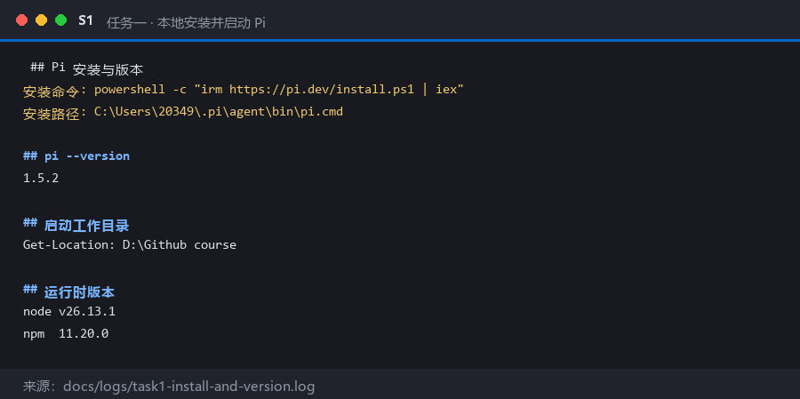

---

## 任务二 配置模型并完成一次会话（截图 S2）

采用 **API Key** 方式。为避免把密钥落盘到 `auth.json`，本次通过**环境变量**注入，Pi 原生支持：

| Provider | 环境变量 |
| --- | --- |
| DeepSeek | `DEEPSEEK_API_KEY` |

```powershell
$env:DEEPSEEK_API_KEY = "<你的密钥>"   # 交互式填入，不写入任何文件
pi --list-models
```

可用模型：

```text
provider  model            context  max-out  thinking  images
deepseek  deepseek-flash   1M       384K     yes       yes
deepseek  deepseek-v4-pro  1M       384K     yes       no
```

配置完成后发送 `你好`，模型正常回复：

```text
你好！我是你的编程助手，可以帮你查看文件、运行命令、修改代码、搜索资料等等。

有什么我可以帮你的吗？😊
```

**验收证据**：包含自己发出的提示词、模型实际回复，且模型信息为 `deepseek/deepseek-flash`。
证据日志：[`docs/logs/task2-model-and-session.log`](docs/logs/task2-model-and-session.log)

> 本次未提交 `auth.json`、授权回调链接或完整密钥。

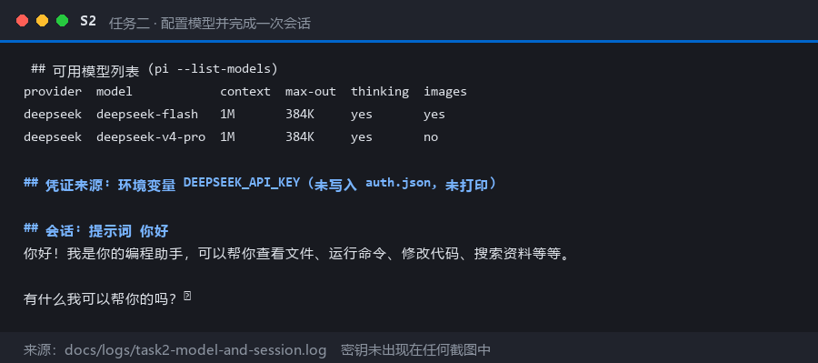

---

## 任务三 切换模型与模型思考级别（截图 S3）

### 3.1 切换模型

Pi 的 `--model` 支持 `provider/model` 形式，也支持 `:<thinking>` 后缀。切换前后各发一次同样的问题：

| 阶段 | 模型 | 回复 |
| --- | --- | --- |
| 切换前 | `deepseek-flash` | 持续集成（CI）是指开发人员频繁地把代码提交到共享主干…… |
| 切换后 | `deepseek-v4-pro` | 持续集成（Continuous Integration, CI）是一种开发实践…… |

两次都正常返回，证明**切换是真生效的**（不以打开选择器代替完成切换）。

### 3.2 切换思考级别

思考级别支持 `off / minimal / low / medium / high / xhigh / max`。为证明切换真的被应用，
不能只看「回复看起来不一样了」，而要读 Pi **自己记录**下来的值。证据取自会话文件
`~\.pi\agent\sessions\--D--Github course-pi-test--\*.jsonl`：其中的 `thinking_level_change` 条目
与 assistant 消息的 `thinkingLevel` 字段会记录本次实际生效的级别。

```text
请求级别   Pi记录级别   模型              回答
--------   ----------   ---------------   ------------------------------------------
off        off          deepseek-flash    持续集成（CI）是指开发者频繁地把代码合并到共享主干……
low        low          deepseek-flash    持续集成（CI）是一种开发实践：开发者频繁把代码合并到主干……
high       high         deepseek-flash    持续集成（CI）是指开发者频繁地把代码合并到主干……
```

请求值与被记录值三者一致，说明 `--thinking` 真的改变了 Pi 的推理设置，
而不是被静默忽略或被模型能力裁剪。

> **踩坑记录（值得写下来）**：我最初想用 `pi --mode json` 直接读 `thinkingLevel`，
> 但实测 `message_end` / `turn_end` 事件的 `message` 对象里**并没有**这个字段
> （`message_end.message` 的键只有 `role, content, sections, timestamp, toolsAdded`），
> 所以那样取到的是空值。真正的落点在**会话文件**里。也就是说：验证手段本身也要先验证，
> 否则会拿到一个「看起来验证过了」的空结论。

**注意**：`thinkingLevel` 是模型推理设置，不是更换模型，也不是显示/隐藏思考文本。
两个 DeepSeek 模型都支持该设置（`thinking: yes`）。

证据日志：[`docs/logs/task3-model-and-thinking.log`](docs/logs/task3-model-and-thinking.log)

### 3.3 我的选择与理由

- **简单问题**（如解释名词、算术）：用 `deepseek-flash` + `thinking=off/low`。响应快、成本低，
  这类问题不需要多步推理。
- **需要推理的任务**（多文件重构、排查复杂 bug）：用 `deepseek-v4-pro` + `thinking=high`。
  推理链更长，能减少「看起来对但漏了边界情况」的错误。
- 但**较高思考级别不保证答案更好**，会增加等待时间和用量，所以日常默认保持 `medium`。

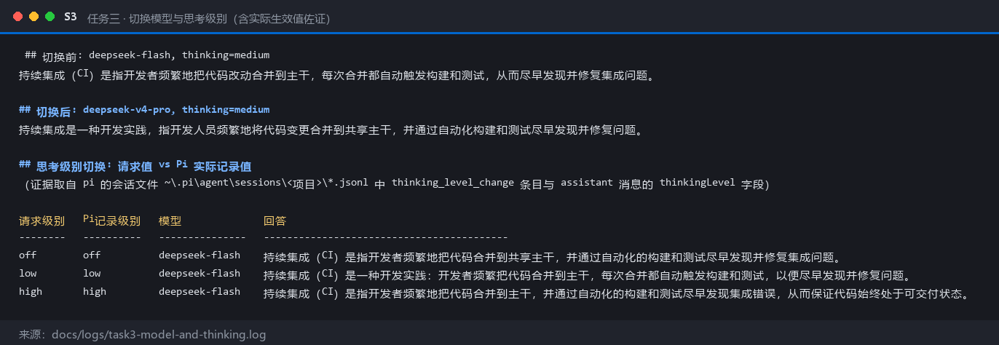

---

## 任务四 引用代码并粘贴小图片（截图 S4 / S5）

### A 使用 @ 引用代码文件

在 `pi-test` 目录创建 `hello.py`：

```python
def add(a, b):
    return a + b

print(add(2, 3))
```

启动 Pi 后用 `@hello.py` 引用该文件（**必须作为独立参数**，见下方踩坑说明）：

```powershell
pi --print "@hello.py" "请解释 @hello.py 的功能，说明运行后输出什么。只解释，不修改文件。"
```

模型正确解释了 `add` 函数，并给出输出 `5`：

```text
`hello.py` 包含两部分：

1. **`add(a, b)` 函数**：接收两个参数 `a` 和 `b`，用 `return a + b` 返回它们的和。

2. **`print(add(2, 3))`**：调用 `add` 函数，传入参数 `2` 和 `3`，并将返回结果打印到控制台。

## 运行后输出

5

因为 `add(2, 3)` 计算 `2 + 3 = 5`，所以 `print` 输出 `5`。
```

并且文件**未被修改**（前后内容完全一致），符合「只解释，不修改文件」的约束。
实际运行 `python hello.py` 输出 `5`，与模型解释一致。

证据日志：[`docs/logs/task4a-at-file-reference.log`](docs/logs/task4a-at-file-reference.log)

> **踩坑记录**：如果写成 `pi --print "@hello.py 请解释..."`（把 `@文件` 和提示词放进同一个字符串），
> Pi 会报 `File not found: ...hello.py 请解释...`，因为它把整串当成一个文件名。
> 正确做法是让 `@文件` **单独占一个参数**。

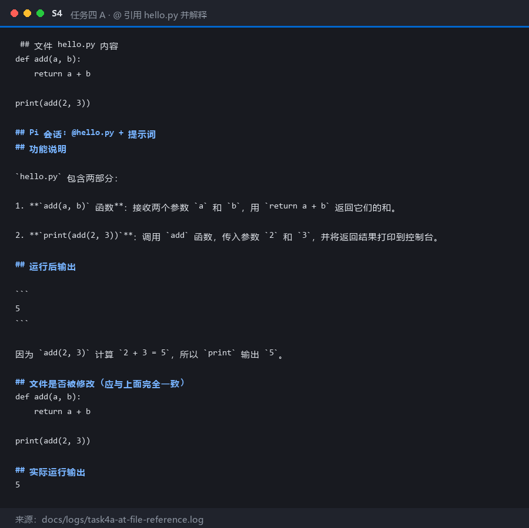

### B 粘贴小图片并测试

制作了一张 **200×200** 的测试图：白色背景 + 蓝色方块 + 白色数字 `7`（见
[`pi-test/seven.png`](pi-test/seven.png)）。

图片输入需要支持视觉的模型，因此切到 `deepseek-flash`（`images: yes`；注意 `deepseek-v4-pro`
为 `images: no`，用它测图片会失败）：

```powershell
pi --model deepseek/deepseek-flash --print "@seven.png" "请描述图片中的颜色、形状和数字。"
```

模型回复：

```text
- **颜色**：整个画面由两种颜色构成——背景的纯白色，以及中央一块**亮蓝色**（接近 #0070C0 的中蓝），
  正方形上的数字是**纯白色**。
- **形状**：一个**正方形**色块，边缘为直角，居中放置在白底上，四周留有较宽的白边距；
  方块内部是一个数字的笔画形状。
- **数字**：方块中央是一个白色的阿拉伯数字 **“7”**，采用粗线条的无衬线字体，
  顶部有一横，右下斜竖笔，整体风格简洁、类似图标或按钮标识。
```

颜色、形状、数字三项全部识别正确。测试原图（也是输入，便于对照核对）：


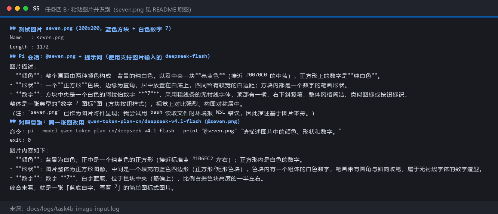

证据日志：[`docs/logs/task4b-image-input.log`](docs/logs/task4b-image-input.log)

---

## 任务五 安装并使用一个插件（截图 S6）

### 5.1 选型

| 项目 | 内容 |
| --- | --- |
| 名称 | **pi-web-access** |
| 来源 | https://pi.dev/packages ｜ npm：`pi-web-access` |
| 作用 | 联网能力：网页搜索、URL 抓取、GitHub 仓库克隆、PDF 提取、视频理解 |
| 类型 | extension（扩展） |

### 5.2 安装

```powershell
pi install npm:pi-web-access
```

```text
Installing npm:pi-web-access...
added 211 packages in 2m
Installed npm:pi-web-access
```

核对包来源：

```text
User packages:
  npm:pi-web-access
    C:\Users\20349\.pi\agent\npm\node_modules\pi-web-access
```

### 5.3 重启后加载

个人级安装会写入 `~/.pi/agent/settings.json`：

```json
{ "packages": ["npm:pi-web-access"] }
```

**加载证据**（不是只看安装命令）：重新启动 Pi 后，系统提示词的工具清单中出现了该扩展注册的 4 个工具：

```text
web_search : 已注册
source_check : 已注册
fetch_content : 已注册
get_search_content : 已注册
```

### 5.4 试用最小功能

提示词：「请获取 https://example.com 的页面标题」。Pi 实际调用了 `fetch_content`（该扩展提供）：

```text
tool=fetch_content  args={"url":"https://example.com"
```

回复：**Example Domain** ✅

> **加载成功与联网可用分别记录**：扩展注册工具 = 加载成功；`fetch_content` 返回真实标题 = 联网可用。

证据日志：
[`docs/logs/task5-plugin.log`](docs/logs/task5-plugin.log)、
[`docs/logs/task5-extension-loaded.log`](docs/logs/task5-extension-loaded.log)、
原始 JSON 事件流 [`docs/logs/task5-plugin-json.jsonl`](docs/logs/task5-plugin-json.jsonl)

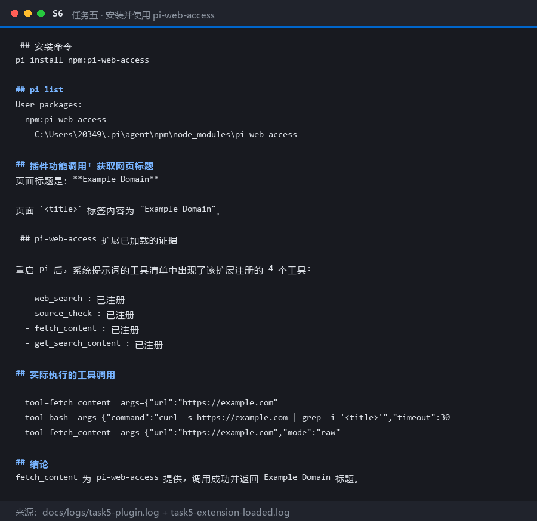

**重启后的真实 TUI 加载画面（S6b）**——作业要求截图须包含 `[Extensions]` 区域和插件名称：

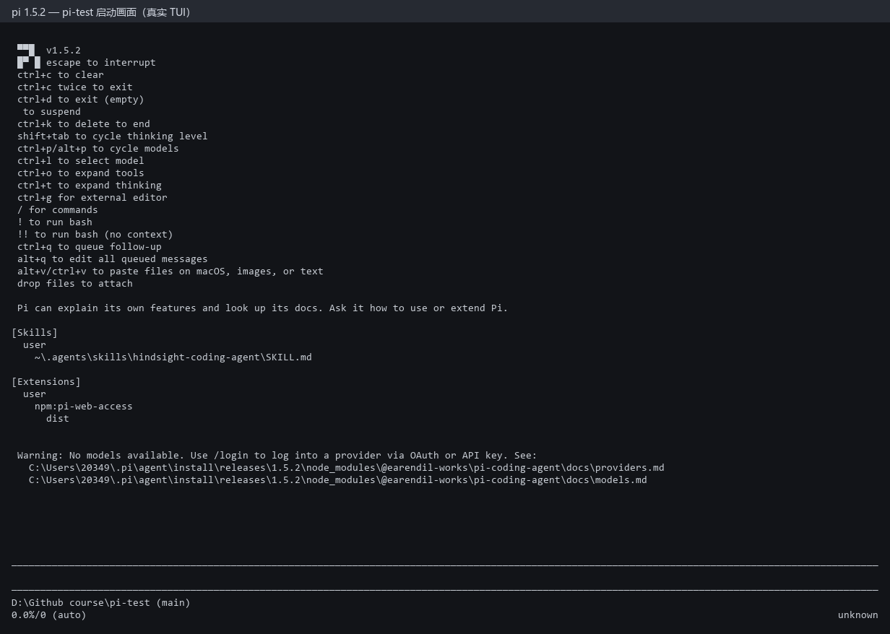

```text
[Extensions]
  user
    npm:pi-web-access
      dist
```

`pi list` 是本机配置，`[Extensions]` 是 Pi 重启后**实际加载**的扩展——作业明确要求
「不能仅用安装命令截图代替加载成功」，这一张才是加载证据。

---

## 任务六 让 AI 安装一个 PPT Skill（选做 · 已完成）

### 6.1 安装

目标目录：`D:\Github course\study\.pi\skills\pptx`（**项目级**，不是用户级）。

源仓库 `anthropics/skills` 的 `skills/pptx` 完整目录，**保留 `SKILL.md`、`LICENSE.txt` 和 `scripts`**：

```text
D:\Github course\study\
  .pi\
    skills\
      pptx\
        SKILL.md          (28,364 bytes)
        LICENSE.txt       (11,357 bytes)
        scripts\
          __init__.py
          add_slide.py
          apply_theme.js
          clean.py
          slide_text.py
          thumbnail.py
          office\
            helpers\   pptx_chart.py  pptx_slide.py  pptx_theme.py
            schemas\   (ECMA / ISO-IEC29500 XSD)
            validators\ base.py  docx.py  pptx.py  redlining.py
            soffice.py  validate.py
```

共 **58 个文件**。只安装了这一个 Skill，未修改其他项目，未把 Skill 当作 npm 插件执行 `pi install`。

> **说明**：`git clone` 在本机被网络重置（`Connection was reset`），改用 GitHub codeload 的 zip 包
> 下载同一份源码，内容一致。

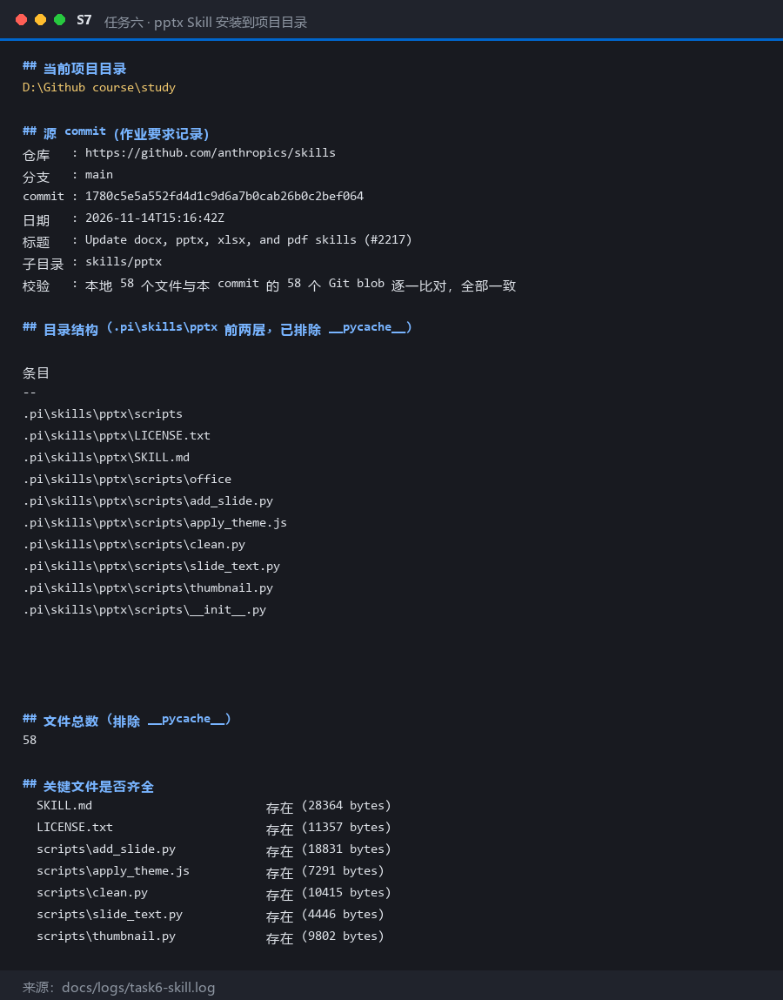

### 6.2 启动发现 + 实际调用（截图 S8）

Pi 会从项目 `.pi/skills` 递归发现技能。**完全退出原会话后**在 `study` 目录重新启动，显式调用：

```powershell
cd D:\Github course\study
pi
/skill:pptx 请说明这个 Skill 的名称、用途和所在目录，
```

回复（节选）：

```text
## 名称
**pptx**（PPTX 创建、编辑和分析）

## 用途
- **创建**新的演示文稿（通过 pptxgenjs 脚本，按"结构化幻灯片"方式构建）
- **编辑**现有演示文稿或基于模板构建（解压 → 编辑 XML → 重新打包）
- **读取/分析**演示文稿内容（提取文字、生成缩略图、校验文件）

**所在目录**：D:\Github course\study\.pi\skills\pptx\
```

路径指向本次安装位置 ✅

证据日志：[`docs/logs/task6-skill.log`](docs/logs/task6-skill.log)

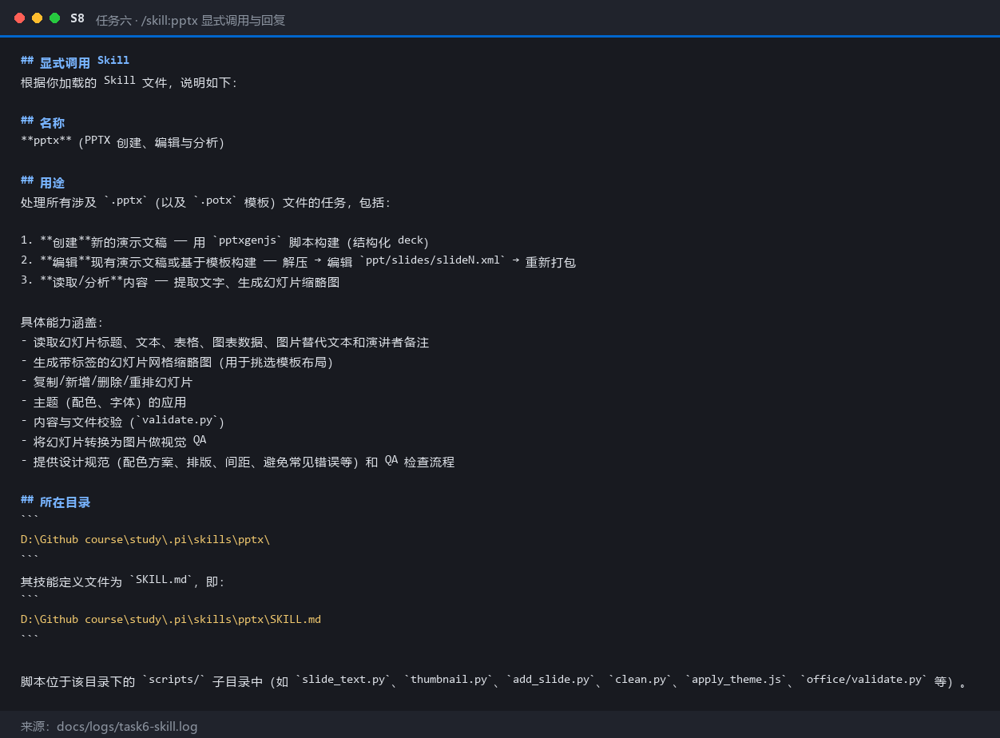

**重启后的真实 TUI 发现画面（S8b）**——作业要求截图须包含 `[Skills]` 中发现 pptx，
且路径指向本次安装位置：

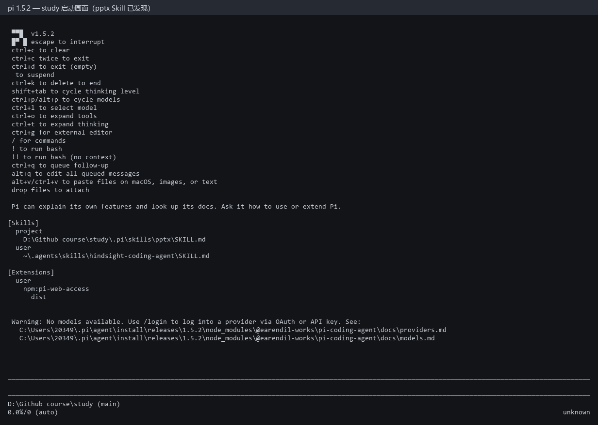

```text
[Skills]
  project
    D:\Github course\study\.pi\skills\pptx\SKILL.md
  user
    ~\.agents\skills\hindsight-coding-agent\SKILL.md
```

`project` 分组下就是本次装的项目级 `pptx` Skill，路径与 6.1 的安装位置一致。

> **注意**：首次启动时会弹出 `Trust project folder? D:\Github course\study` 的信任提示，
> 必须选择 `Trust` 后 Pi 才会加载 `.pi` 下的项目级资源；直接跳过则 `[Skills]` 里不会出现 pptx。
> 原始字节流：[`docs/logs/tui-capture-skills-study.raw.txt`](docs/logs/tui-capture-skills-study.raw.txt)

### 6.3 生成两页 PPT 并核查可打开

按 Skill 的指引补齐依赖后生成（依赖是本机事实，不能假设预装）：

| 依赖 | 状态 |
| --- | --- |
| Node.js + `pptxgenjs` | 已装（`npm install pptxgenjs`） |
| Python + `python-pptx` | 已装（`pip install python-pptx`，走官方 PyPI） |

产物：[`study/pi-agent-report.pptx`](study/pi-agent-report.pptx)（生成脚本
[`study/make_deck.js`](study/make_deck.js)）

**四层验收全部通过**：

1. **安装成功** — 58 个文件落到 `.pi\skills\pptx`
2. **发现成功** — `/skill:pptx` 可调用并读到 SKILL.md
3. **调用成功** — 模型正确说明名称/用途/目录
4. **生成 PPT 成功 + 能打开** — 见下方校验

结构校验（Skill 自带的 `validate.py`，基于 ECMA/ISO XSD）：

```text
All validations PASSED!
```

可打开性验证：用 PowerPoint 实际打开并导出全部 2 页图片，`Slides.Count = 2`。
渲染结果：

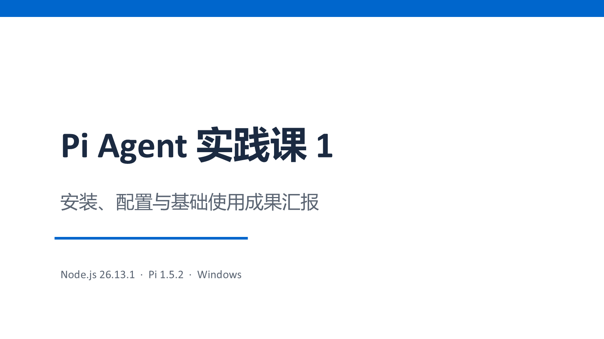

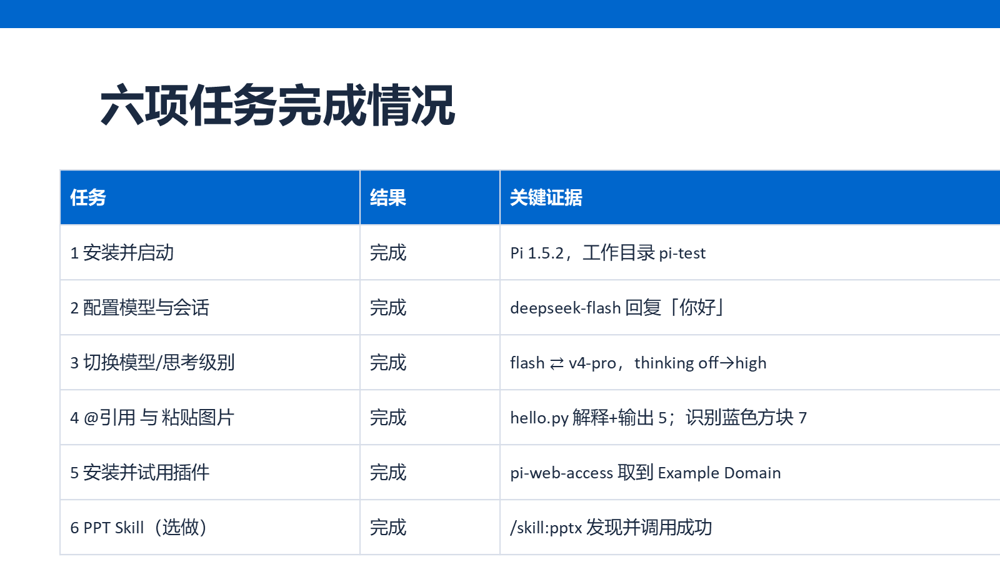

> **踩坑记录**：
> - Skill 的 `thumbnail.py` 依赖 LibreOffice 且用到了 `AF_UNIX` 套接字，Windows 下不可用，
>   因此改用 PowerPoint COM 导出图片做可视化核查。
> - 第一次生成时第 2 页表格超出页面右边缘，调整 `colW` 后重新导出确认修好。

---

## 踩坑与结论汇总

| # | 现象 | 原因 | 解决 |
| --- | --- | --- | --- |
| 1 | `pi : 因为在此系统上禁止运行脚本` | PowerShell 执行策略为 `Restricted`，`pi.ps1` 无法加载 | 调用 `pi.cmd`，或 `Set-ExecutionPolicy -Scope CurrentUser RemoteSigned` |
| 2 | `401 Authentication Fails` | 原来的 DeepSeek key 已失效 | 重新在 platform.deepseek.com 创建 key |
| 3 | `File not found: ...hello.py 请解释...` | `@文件` 与提示词写在同一个参数里 | 让 `@文件` 单独占一个参数 |
| 4 | 图片识别失败 | `deepseek-v4-pro` 的 `images` 为 `no` | 改用 `deepseek-flash`（`images: yes`） |
| 5 | `git clone` 报 `Connection was reset` | 网络对 GitHub git 协议重置 | 改用 codeload zip 下载 |
| 6 | `ModuleNotFoundError: No module named 'pptx'` | Skill 假设 python-pptx 已预装 | 手动 `pip install python-pptx` |
| 7 | `thumbnail.py` 报 `module 'socket' has no attribute 'AF_UNIX'` | 该脚本面向 Unix + LibreOffice | 改用 PowerPoint COM 导出 PNG |
| 8 | `--mode json` 取不到 `thinkingLevel`（读到空字符串） | `message_end.message` 里根本没有该字段 | 改读会话文件 `sessions\<项目>\*.jsonl` 的 `thinking_level_change` |
| 9 | `pi --verbose \| Out-String` 输出 **0 字节** | Pi 只在 TTY 下绘制界面，管道里不渲染 | 用 `pywinpty`（ConPTY）+ `pyte` 重建屏幕，见 `tools/tui_capture.py` |
| 10 | 项目级 Skill 不出现，卡在 `Trust project folder?` | 首次启动需信任项目目录才会加载 `.pi` | 选择 `Trust` 后重启 |

**核心体会**：「安装成功」「发现成功」「调用成功」「产出成功」是四个不同层次，必须逐层验证。
仅仅看到 `pi install` 打印成功，不等于插件在重启后真的加载了 —— 要看工具清单和实际调用结果。

---

## 仓库结构

```text
.
├── README.md                      本报告
├── pi-test/                       任务 1–5 的练习目录
│   ├── hello.py                   任务 4A 的示例代码
│   └── seven.png                  任务 4B 的 200x200 测试图
├── study/                         任务 6 的项目目录
│   ├── .pi/skills/pptx/           PPT Skill（58 个文件）
│   ├── make_deck.js               生成 PPT 的脚本
│   └── pi-agent-report.pptx       两页成果 PPT
├── docs/
│   ├── logs/                      全部终端证据原文（含 TUI 原始字节流 *.raw.txt）
│   ├── screenshots/               S1–S8 + S6b/S8b 截图
│   └── assets/                    PPT 渲染出的页面图片
└── tools/
    ├── capture-evidence.ps1       一键复现并采集全部证据
    ├── render-screenshots.py      把日志渲染成 S1–S8 截图
    ├── tui_capture.py             用 ConPTY 抓取 Pi 真实 TUI 画面
    └── render-tui.py              把 TUI 字节流用 pyte 重建成图片
```

## 复现方式

```powershell
# 1. 准备密钥（不落盘）
$env:DEEPSEEK_API_KEY = "<你的密钥>"

# 2. 安装 Pi
powershell -c "irm https://pi.dev/install.ps1 | iex"

# 3. 一键重跑全部任务并采集证据
powershell -ExecutionPolicy Bypass -File .\tools\capture-evidence.ps1

# 4. 把采集到的日志重新渲染成 S1–S8 截图
python .\tools\render-screenshots.py

# 5.（可选）抓取 Pi 真实 TUI 画面，生成 S6b / S8b
python -m pip install pywinpty pyte --index-url https://pypi.org/simple
python .\tools\tui_capture.py "D:\Github course\pi-test"  raw-ext.txt  clean-ext.txt  45
python .\tools\tui_capture.py "D:\Github course\study"    raw-skill.txt clean-skill.txt 60 "\r"
python .\tools\render-tui.py  raw-ext.txt   S6b.png "pi 启动画面（Extensions）"
python .\tools\render-tui.py  raw-skill.txt S8b.png "pi 启动画面（Skills）"
```

> `"\r"` 是给 `Trust project folder?` 提示按 Enter 用的——不信任项目目录，`.pi/skills` 不会被加载。
